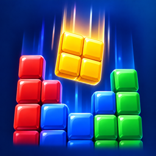

<div align="center">
  
  <h1>GravityBlock Website</h1>
  <p>The official home and support center for GravityBlock.</p>
  <p>
    <a href="https://gravityblock-site.vercel.app/"><strong>Visit Website</strong></a>
    ·
    <a href="https://gravityblock-site.vercel.app/support/"><strong>Get Support</strong></a>
  </p>
</div>

## About GravityBlock

GravityBlock is a block puzzle for iPhone where every swipe changes the board. Place pieces, clear
lines, shift gravity in four directions, build combos, and climb the style ranks from D to SSS.

This repository contains the public website used for GravityBlock's App Store presence and player
support.

## Live Pages

| Page      | Purpose                                        | URL                                                                                   |
| --------- | ---------------------------------------------- | ------------------------------------------------------------------------------------- |
| Marketing | Product overview and gameplay highlights       | [gravityblock-site.vercel.app](https://gravityblock-site.vercel.app/)                 |
| Support   | Contact details and frequently asked questions | [gravityblock-site.vercel.app/support](https://gravityblock-site.vercel.app/support/) |

## Website Features

- Responsive layout for phones, tablets, and desktop screens
- Original GravityBlock artwork and English App Store screenshots
- Accessible navigation, landmarks, labels, and reduced-motion support
- Dedicated support page with FAQs and direct email contact
- Static files with no runtime dependencies or tracking scripts


## App Store Connect URLs

```text
Marketing URL: https://gravityblock-site.vercel.app/
Support URL:   https://gravityblock-site.vercel.app/support/
```

## Support

For questions, feedback, or bug reports, visit the
[GravityBlock Support Center](https://gravityblock-site.vercel.app/support/).

---

© 2026 GravityBlock
